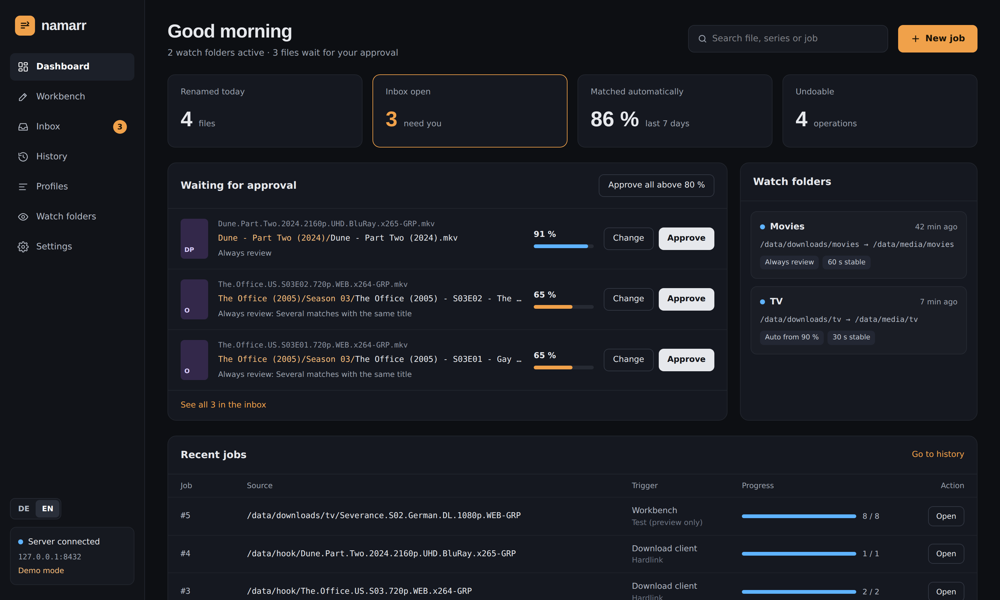

# Automation



## Watch folders

A watch folder renames new downloads on its own:

- It waits until size and mtime of a file have been **stable** for a while (per folder, default
  30 s) and ignores `.part`, `.!qB`, `.tmp` and similar files of running downloads.
- It bundles a release folder into **one job**, so a season pack is one job, not ten.
- Only matches above the **auto threshold** (default 90 %) run. Everything else waits in the
  [inbox](#inbox). *Always review* runs nothing without your approval.
- Matched files go to the **libraries**: the watch folder's own choice per kind, else the default
  library for movies and series (see [Folders and libraries](installation.md#folders-and-libraries)).
- Each watch folder has its own **options**: the [format](workbench.md#formats) for movies and for
  series (else the default format), the series source, the action and the conflict policy.
- The action is **move** unless the folder says **copy**. Copy leaves the download where it is, for
  a torrent client that still seeds it.
- After a move, the release folder goes too once it is empty (or holds only leftovers such as
  `.sfv`, `.nzb` or `Thumbs.db`); the watch folder itself always stays.
- **At startup** it catches up on what arrived while namarr was down: video files that no job knows
  yet and that appeared after the watch folder was created. An old backlog is left alone; that is
  what the workbench is for.

## Inbox

Uncertain matches from watch folders and the hook wait here with the reason (two candidates with a
similar score, a double episode, a season guessed from an absolute number …). Approve them one by
one, change the match, or approve everything above 80 % at once.

## Download client hook

Instead of a watch folder, or next to one, a download client can call namarr after every finished
download. The job runs like a watch job: sure matches are renamed right away, uncertain ones wait in
the inbox.

```bash
curl -X POST http://namarr:8420/api/jobs \
  -H "Authorization: Bearer $NAMARR_TOKEN" \
  -d path="/data/downloads/tv/Severance.S02.German.DL.1080p.WEB-GRP" -d watchFolder=Series
```

| Field | Meaning |
|---|---|
| `path` | file or folder, as the client sees it (`NAMARR_PATH_MAP` translates it) |
| `watchFolder` | ID or name of a watch folder: its formats, series source, action, targets and auto threshold |
| `target` | one folder for every file; otherwise movies and series go to the libraries of the watch folder or the defaults |
| `review` | `true`: nothing runs without approval, everything goes to the inbox |
| `threshold` | auto threshold 0–1, default 0.9 |

Fields may be sent as JSON, as a form or as query parameters. Without `watchFolder` the job uses the
default formats and moves the files. The answer is
`202 {"jobId", "status", "url"}`; `GET /api/jobs/<id>` reports the progress. Errors come as
`{"error"}` with 400 (invalid, or no target at all), 401 (token), 403 (outside the folders) or 404 (path or watch folder
unknown).

> **Note:** Profiles are gone. A call that still sends `profile` gets a 400 that says to send `watchFolder`
> instead; the watch folders that used a profile took over its settings.

- **qBittorrent** → Options → Downloads → *Run external program on torrent finished*:
  `curl -s -X POST http://namarr:8420/api/jobs -H "Authorization: Bearer TOKEN" --data-urlencode "path=%F" -d watchFolder=Series`
  (`%F` is the content path: the folder for several files, otherwise the file.)
- **SABnzbd / NZBGet**: a post-processing script with the same line, `path` from
  `$SAB_COMPLETE_DIR` or `$NZBPP_DIRECTORY`.
- When the client and namarr run in different containers with different mounts, for example
  `/downloads` against `/data/downloads`, set `NAMARR_PATH_MAP=/downloads:/data/downloads`.

## AI agents (MCP)

namarr is an [MCP](https://modelcontextprotocol.io) server, so an AI agent (Claude Code, Claude
Desktop, Cursor, VS Code, …) can rename files the way you do in the workbench: preview first, then
execute, and undo whenever needed. The endpoint is `/api/mcp` (Streamable HTTP) and takes the same token as the API.

```bash
claude mcp add --transport http namarr http://namarr:8420/api/mcp --header "Authorization: Bearer $NAMARR_TOKEN"
```

For clients that configure servers in JSON:

```json
{
  "mcpServers": {
    "namarr": {
      "type": "http",
      "url": "http://namarr:8420/api/mcp",
      "headers": { "Authorization": "Bearer <NAMARR_TOKEN>" }
    }
  }
}
```

| Tool | What it does |
|---|---|
| `get_overview` | Folders and libraries, watch folders, naming formats, inbox count, latest jobs |
| `browse_folder` | Lists a folder inside the allowed folders |
| `create_job` | Scans and matches files and waits for the preview. Always in **test mode**, nothing moves |
| `get_job`, `list_job_items` | Status, and old → new per file with match, episodes, confidence, reasons and conflicts |
| `search_metadata`, `update_item` | Picks another match, sets your own target, excludes or approves a file |
| `recompute_preview` | Another template, format, rules or target folder, without matching again |
| `cancel_job` | Stops a running job |
| `execute_job` | Runs the preview: `move`, `copy` or `rename` |
| `list_inbox`, `approve_inbox` | Shows and approves uncertain matches from watch folders and the hook |
| `list_history`, `undo` | Executed operations, and undo per job, file, operation or point in time |

The agent is told to ask before `execute_job`, `approve_inbox` and `undo`, and these tools are
marked as destructive, so clients ask for confirmation. `NAMARR_MCP=readonly` leaves those three tools out:
the agent can look and prepare previews, but only you run them in the workbench. `NAMARR_MCP=off` turns the
endpoint off.

## After a job

- **Library refresh** for Jellyfin, Emby and Plex, so new episodes show up right away. *Test
  connection* next to each server checks address, token and server type without refreshing, and
  shows the server's name and version.
- **Notifications** via ntfy, Gotify, Telegram, Discord or a webhook, in the language set for titles.

Both are set up under *Settings*.
